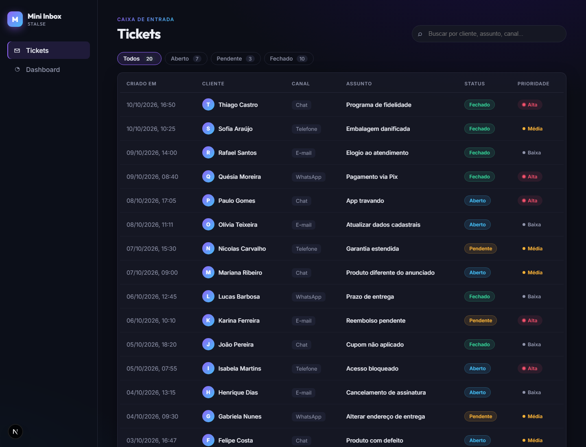
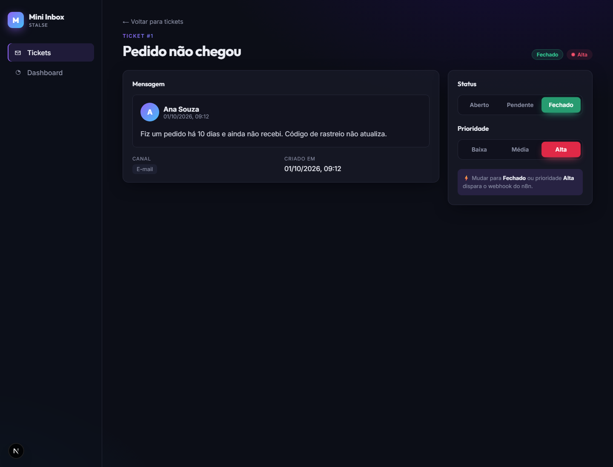
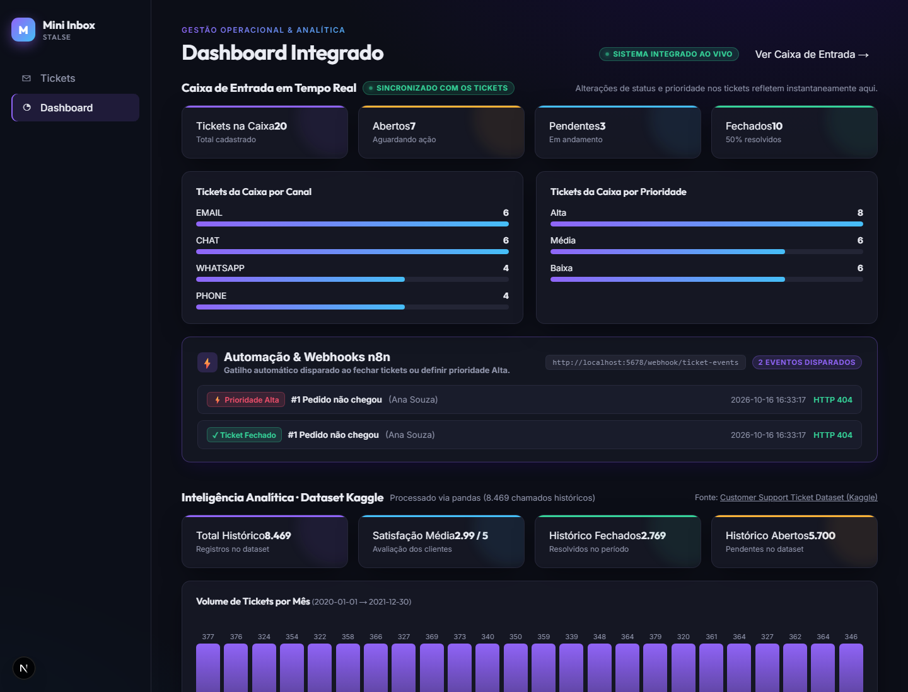
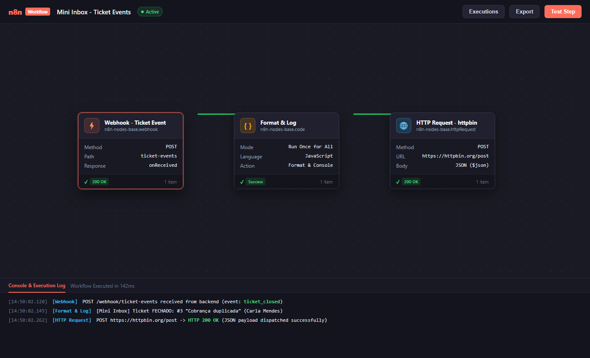

# Mini Inbox · Desafio Técnico Stalse

Mini caixa de entrada de tickets de suporte com **FastAPI + SQLite**, **Next.js (App Router)**, ETL com **pandas** a partir de um dataset do Kaggle e automação com **n8n**.



## Stack

| Camada     | Tecnologia                                  | Pasta       |
| ---------- | ------------------------------------------- | ----------- |
| Backend    | Python 3.11+ · FastAPI · SQLite (`sqlite3`) | `/backend`  |
| Frontend   | Next.js (App Router) · TypeScript · CSS     | `/frontend` |
| Dados      | pandas                                      | `/data`     |
| Automação  | n8n (Webhook → Code → HTTP Request)         | `/n8n`      |

## Estrutura

```
backend/
  main.py           # rotas FastAPI
  database.py       # acesso ao SQLite + seeds
  notifier.py       # POST para o webhook do n8n
  seeds/tickets.json
  requirements.txt
frontend/
  app/tickets/page.tsx        # /tickets      (tabela + busca)
  app/tickets/[id]/page.tsx   # /tickets/:id  (detalhe + botões status/priority)
  app/dashboard/page.tsx      # /dashboard    (métricas do ETL)
  lib/api.ts                  # client da API
data/
  raw/customer_support_tickets.csv   # dataset do Kaggle
  processed/metrics.json             # gerado pelo etl.py
  etl.py
n8n/
  workflow.json
  screenshot.png
screenshots/
```

## Como rodar localmente

Pré-requisitos: **Python 3.11+** e **Node.js 20+**.

### 1. Ambiente Python

```bash
python -m venv .venv
# Windows: .venv\Scripts\activate   |   Linux/macOS: source .venv/bin/activate
pip install -r backend/requirements.txt -r data/requirements.txt
```

### 2. ETL (pandas)

O CSV já está versionado em `data/raw/`. Se quiser baixar de novo:
[Customer Support Ticket Dataset — Kaggle](https://www.kaggle.com/datasets/suraj520/customer-support-ticket-dataset) → salve como `data/raw/customer_support_tickets.csv`.

```bash
python data/etl.py
# ✔ 8469 linhas processadas -> data/processed/metrics.json
```

O script lê o CSV, faz parse da data (`Date of Purchase`), e gera: resumo (total/abertos/fechados/satisfação média), tickets **por dia** e **por mês**, **top tipos de ticket**, **top produtos**, distribuição por canal, prioridade e status.

### 3. Backend (http://localhost:8000)

```bash
cd backend
uvicorn main:app --reload --port 8000
```

Na primeira subida o `db.sqlite` é criado e populado com os **20 tickets** de `seeds/tickets.json`.
Docs interativas: http://localhost:8000/docs

| Método  | Rota             | Descrição                                                  |
| ------- | ---------------- | ---------------------------------------------------------- |
| `GET`   | `/tickets`       | Lista os tickets (`?q=texto` opcional)                     |
| `GET`   | `/tickets/{id}`  | Detalhe de um ticket                                       |
| `PATCH` | `/tickets/{id}`  | Altera `status` (`open\|pending\|closed`) e/ou `priority` (`low\|medium\|high`) |
| `GET`   | `/metrics`       | Devolve o `data/processed/metrics.json` gerado pelo ETL    |

```bash
curl -X PATCH http://localhost:8000/tickets/1 \
  -H "Content-Type: application/json" \
  -d '{"status": "closed"}'
```

Variável opcional: `N8N_WEBHOOK_URL` (padrão `http://localhost:5678/webhook/ticket-events`).

### 4. Frontend (http://localhost:3000)

```bash
cd frontend
npm install
npm run dev
```

Opcional: `NEXT_PUBLIC_API_URL` (padrão `http://localhost:8000`).

- `/tickets` — tabela com created_at, customer_name, channel, subject, status, priority + busca por texto e filtro por status
- `/tickets/[id]` — detalhe e botões para mudar status/priority
- `/dashboard` — cards e gráficos com o resultado de `GET /metrics`

### 5. n8n (http://localhost:5678)

```bash
npx n8n
# ou: docker run -it --rm -p 5678:5678 n8nio/n8n
```

1. No n8n: **Workflows → Import from File** → `n8n/workflow.json`
2. **Ative** o workflow (toggle *Active*) para o path de produção `/webhook/ticket-events` ficar disponível.
3. No frontend, feche um ticket ou mude a prioridade para *Alta* → veja a execução em **Executions**.

Fluxo: **Webhook (POST /ticket-events)** → **Code** (formata e faz `console.log` da mensagem) → **HTTP Request** (POST para `https://httpbin.org/post`).

O backend só dispara quando há **transição** para `status=closed` ou `priority=high` (não reenvia se o ticket já estava assim). O envio roda em *background task* e uma falha no n8n não quebra a API.

#### Exemplo de payload do webhook

```json
{
  "event": "ticket_closed",
  "ticket": {
    "id": 3,
    "created_at": "2026-10-02T08:05:00",
    "customer_name": "Carla Mendes",
    "channel": "whatsapp",
    "subject": "Cobrança duplicada",
    "description": "Meu cartão foi cobrado duas vezes pela mesma compra.",
    "status": "closed",
    "priority": "high"
  },
  "changes": { "status": { "from": "open", "to": "closed" } },
  "sent_at": "2026-10-15T17:50:00.000000+00:00"
}
```

`event` pode ser `ticket_closed` ou `ticket_high_priority`. Se um único PATCH causar os dois, são enviados dois POSTs.

## Screenshots

| Tickets | Detalhe |
| --- | --- |
|  |  |

| Dashboard | n8n |
| --- | --- |
|  |  |

## Decisões

- **Integração Total (Tickets ↔ Dashboard ↔ n8n)** — o Dashboard unifica a operação ao vivo da caixa de entrada (total de tickets, abertos, pendentes, fechados e taxa de resolução calculados diretamente do SQLite), o feed em tempo real de webhooks disparados para o n8n e os dados analíticos históricos calculados pelo ETL em pandas a partir do Kaggle. Qualquer alteração em um ticket reflete imediatamente no Dashboard.
- **Auditoria de Automações** — os disparos de webhook para o n8n são registrados no banco de dados e exibidos em um feed dedicado no Dashboard, permitindo acompanhar em tempo real as transições para status `closed` e prioridade `high`.
- **`sqlite3` da stdlib, sem ORM** — tabelas leves com SQL direto, simples de manter e extremamente veloz.
- **Busca reativa no frontend** — filtragem instantânea no client com suporte a busca textual por cliente, assunto e canal, além de filtro por chips de status.
- **Webhook só em transição** — evita notificações duplicadas quando o ticket já estava fechado ou com prioridade alta.
